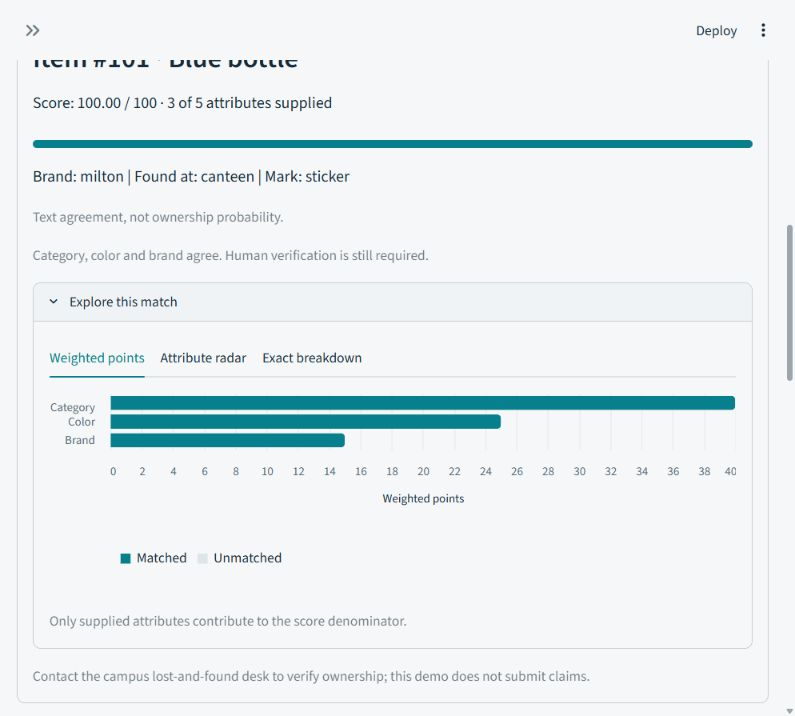
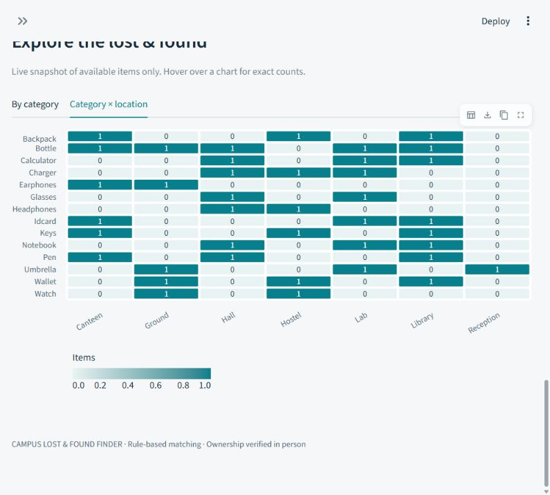
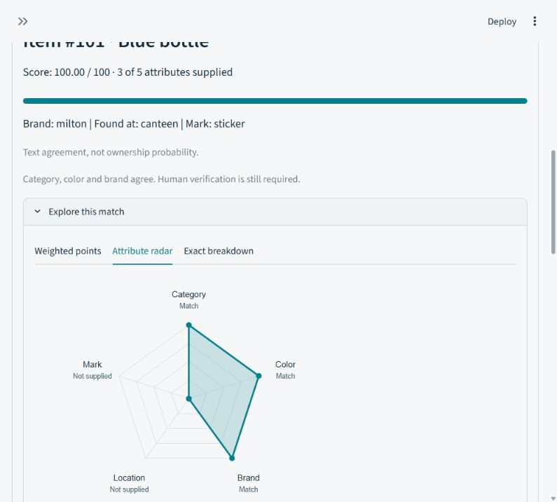
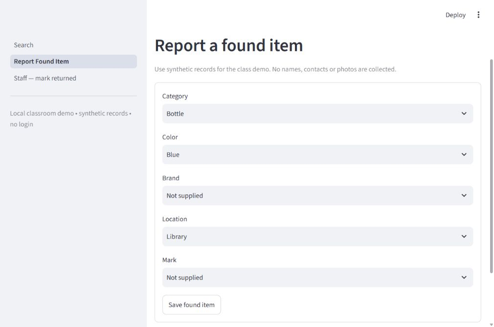
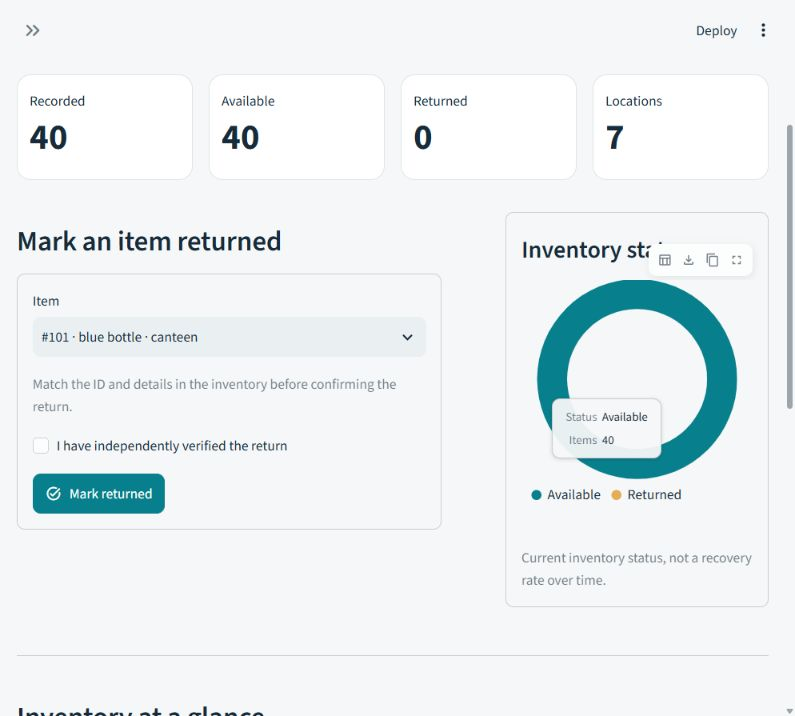
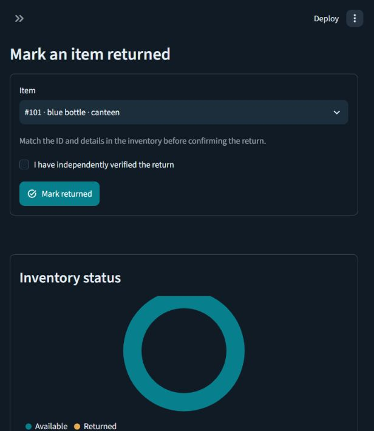
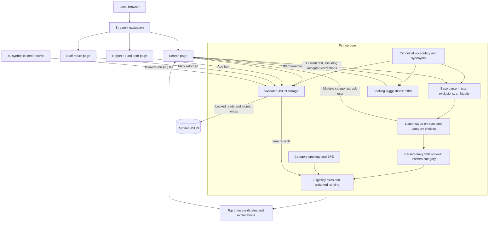
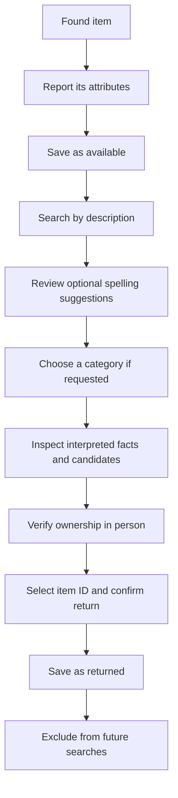

<div align="center">

# 🔎 Campus Lost & Found Finder

**Describe it. Find possible matches. Verify ownership in person.**


[](https://github.com/ananyajoshi-cseai/lost-and-found-smart-box/actions/workflows/tests.yml)

A campus lost-and-found prototype that turns short descriptions into **explainable item matches** using explicit rules, a category ontology and weighted scoring.

[Quick start](#quick-start) · [Demo](#demo-screenshots) · [System design](#system-design) · [Team](#team-and-work-division)

</div>

---

## Index

1. [Project overview](#project-overview)
2. [Features](#features)
3. [Demo screenshots](#demo-screenshots)
4. [Technology stack](#technology-stack)
5. [System design](#system-design)
6. [Application workflow](#application-workflow)
7. [How the matching works](#how-the-matching-works)
8. [Quick start](#quick-start)
9. [How to use](#how-to-use)
10. [Data and storage](#data-and-storage)
11. [Team and work division](#team-and-work-division)
12. [Development workflow](#development-workflow)
13. [Tests and evaluation](#tests-and-evaluation)
14. [Repository structure](#repository-structure)
15. [Current scope and limitations](#current-scope-and-limitations)

## Project overview

Bottles, notebooks, chargers and other belongings can look very similar. A useful lost-and-found search needs to consider several details together and explain why an item appears in its results.

Campus Lost & Found Finder provides a simple local workflow: record a found item, search using a short description, inspect the matching details, and mark the item returned after an in-person check.

**Description → Structured facts → Rules and scoring → Possible matches → Human verification**

The AI component uses **knowledge representation, deterministic parsing, breadth-first search (BFS) and heuristic ranking**. No ML model, deep learning, LLM API or training process is involved. The current project is a software-only Streamlit app.

## Features

| Feature | What it does |
| --- | --- |
| **Description search** | Extracts category, color, brand, location and identifying mark from supported words. |
| **Synonym handling** | Maps phrases such as `navy` to `blue` and `flask` to `bottle`. |
| **Plural handling** | Recognizes supported plurals such as `bottles`, `chargers`, `watches` and `id cards`. Both `key` and `keys` map to the stored category `keys`. |
| **Slang and short forms** | Maps `bttl` to `bottle`, `chgr` to `charger`, `earbuds` to `earphones`, and `specs` to `glasses`; also accepts aliases such as `blk`, `wht`, `hstl` and `ray ban`. |
| **Hinglish aliases** | Recognizes supported Roman-script words such as `neeli bottle`, `kaali chaabi` and `safed kalam` using the vocabulary dictionary. |
| **Vague descriptions** | Recognizes listed phrases such as `something to drink from` (bottle) and `something to write with` (pen) when no category is already specified, excluded or ambiguous. |
| **Category choices** | For `something to listen to music with`, asks **Which item do you mean?** with earphones/headphones options before ranking. |
| **Spelling suggestions** | Offers “Did you mean Milton?” for `Miltn`; changes the query only when the user selects **Use Milton**. |
| **Exclusions and clarification** | Handles `bottle not blue` and `not a blue bottle`; requests clarification for conflicts such as `red blue bottle`. |
| **Explainable ranking** | Shows up to three candidates with scores, supplied-attribute coverage and a points table. |
| **Related-category search** | Optionally explores the ontology using BFS when no eligible exact-category item exists. |
| **Found-item reporting** | Saves a structured item record with a unique ID. |
| **Return tracking** | Records a return after human confirmation and excludes the item from future searches. |
| **Visual dashboard** | Category and location bars, a category/location heatmap, color pie, status donut, weighted points and an attribute radar. |
| **Local persistence** | Retains reports and returns in JSON across app restarts. |

## Demo screenshots

Screenshots of the redesigned app with the 40 synthetic seed records, captured before the spelling-suggestion and category-clarification controls were added. The report and staff images show the forms before submission.

### Search by description


### Understand a match

For `navy Milton flask`, the parser recognizes a blue Milton bottle. This candidate matches all three supplied attributes.



<details>
<summary><strong>View the found-item and return screens</strong></summary>

### Inventory heatmap



### Attribute radar



### Report a found item

Choose supported attributes and save the record.



### Mark an item returned

Select the item ID and confirm the independent return check.



</details>

### Dark mode



### Reading the dashboard

Light and dark palettes are available across all three pages. Open **⋮** at the top right and choose **Light**, **Dark** or **System** in the Theme section. The choice is handled by Streamlit in the browser. Forms, tables and chart labels follow the selected theme; the radar uses a consistent high-contrast navy panel. Search charts count **available items**; reporting charts include **all recorded items**. The staff donut shows current available/returned counts. These are live inventory snapshots, not historical trends.

Match bars show weighted points for supplied attributes. The spider/radar chart shows binary agreement on five axes; missing fields are explicitly labelled and do not contribute to scoring. Neither chart expresses ownership confidence. The exact breakdown remains available as a table.

## Technology stack

| Layer | Technology | Purpose |
| --- | --- | --- |
| Application | Python 3.12 | Parsing, rules, ranking and storage |
| Interface | Streamlit | Search, report and return pages |
| Charts | Altair, pandas and SVG | Inventory counts and transparent match explanations |
| Knowledge | Dictionaries and category graph | Canonical vocabulary, aliases and relationships |
| Search | BFS and weighted matching | Related-category exploration and ranking |
| Spelling | Python `difflib` | Optional character-similarity suggestions, accepted by the user |
| Persistence | JSON, FileLock, atomic replacement | Validated local reads and writes |
| Verification | pytest and Streamlit AppTest | Reasoning, storage and interface checks |
| CI | GitHub Actions | Dependency validation and automated tests |

## System design

All application logic runs inside one local Python application. Streamlit pages call the core functions directly.



| Integration point | Input | Output or effect |
| --- | --- | --- |
| `engine.parse(text)` | Description | `positive`, `excluded` and `ambiguous` fields |
| `engine.parse_with_vague_matching(text)` | Description | Base parser fields plus `clarification_options`; adds one matched category or marks category ambiguity for multiple choices |
| `engine.suggest_corrections(text, cutoff=0.8)` | Description | Suggestions containing `typed`, `suggestion` and `field`; does not change the query |
| `engine.apply_correction(text, typed, suggestion)` | Description and an accepted suggestion | Replaces whole-word occurrences, ignoring case; returns revised text |
| `engine.rank(query, items, broaden=False)` | Parsed query and records | Candidate IDs, scores, reasons and coverage |
| `storage.load_items()` | Configured data path | Validated item list |
| `storage.add_item(values)` | Five structured attributes | Saved item with ID and `available` status |
| `storage.mark_returned(item_id)` | Available item ID | Persists `returned` status |

## Application workflow



Ownership verification happens outside the app. The Staff page records the return; it does not validate ownership evidence.

## How the matching works

### 1. Parse the description

The parser lowercases text, removes straight apostrophes and tokenizes letters and digits. It tries known-word plural reductions (`ies`, `es`, `s`), matches the longest supported phrases first and converts aliases into canonical values. Words already present in the vocabulary are kept as-is; this is a limited rule set, not general grammatical singularization.

Negation recognizes `not`, `no` and `without`, optionally separated from a recognized phrase by `a`, `an`, `the`, `any`, `my` or `one`. In `not a blue bottle`, only blue is excluded and bottle remains a positive category.

| Description | Interpretation |
| --- | --- |
| `navy Milton flask` | `category=bottle`, `color=blue`, `brand=milton` |
| `bottle not blue` or `not a blue bottle` | Bottle, excluding blue items |
| `bottles` / `chargers` / `id cards` | `category=bottle` / `charger` / `idcard` |
| `key` or `keys` | `category=keys` |
| `blk bttl` | `category=bottle`, `color=black` |
| `ray ban specs` | `category=glasses`, `brand=rayban` |
| `Miltn bottles` | Bottle initially; offers `milton`. Accepting **Use Milton** adds the brand to the parsed query. |
| `neeli bottle` | `category=bottle`, `color=blue` |
| `kaali chaabi` | `category=keys`, `color=black` |
| `safed kalam` | `category=pen`, `color=white` |
| `chargar` / `umbrela` | Direct dictionary aliases for `charger` / `umbrella`; no correction click needed |
| `something to drink from` | Wrapper infers `category=bottle` |
| `something to write with` | Wrapper infers `category=pen`; ignore the unrelated `write` → `white` spelling suggestion |
| `something to listen to music with` | Wrapper offers `earphones` / `headphones`; choose one before ranking |
| `red blue bottle` | Conflicting colors; clarification required |
| `bottle not bottle` | Conflicting inclusion and exclusion; clarification required |

Spelling suggestions are separate from parsing. `difflib.get_close_matches` compares unknown words against single-word aliases of at least four characters, using a default similarity cutoff of 0.8 and requiring the same first letter. Known words/plurals, numbers, short words and a small common-word list are skipped. The similarity cutoff is not an ownership confidence score.

The Search page displays **Did you mean …?** and a **Use …** button. Accepting a suggestion updates the input and interpreted facts; select **Find matches** to search the revised description. Ignoring a suggestion leaves that unknown word out of the parsed facts.

The Search page now calls `parse_with_vague_matching()`. It first runs the base parser, then checks the phrase dictionary only if category is absent from positive facts, exclusions and ambiguity. One matched category becomes a positive fact. Multiple categories populate `clarification_options` and mark category ambiguity; the UI asks the user to choose. An explicit category or category exclusion takes priority over this fallback.

Vague matching uses case-insensitive, word-boundary phrase lookup across eight categories: bottle, pen, earphones, headphones, keys, umbrella, backpack and glasses. It does not infer arbitrary paraphrases or use embeddings. Inferred or selected categories contribute the usual 40 points and one coverage field, just like an explicitly named category.

Hinglish support consists of listed Roman-script aliases, including color variants (`neela/neeli/nila/nili`, `kala/kaala/kaali`, `laal/lal`, `safed`, `hara/hari`, `sona/sunehra`) and categories (`chaabi/chabi/chabiyan/chabhi`, `kalam`, `copy`). This is dictionary normalization, not Hindi translation or general Hindi grammar support. Spellings such as `chargar`, `charjer`, `umbrela` and `umbrellah` are also direct aliases; there is no separate phonetic matching stage.

### 2. Select eligible candidates

Returned items and items matching an exclusion are removed. If a category is supplied, eligible exact-category items take priority.

When there are **no eligible exact-category items** and **Include related categories** is enabled, BFS explores at most two edges in this ontology:

```text
campusitem
├── stationery
│   ├── notebook
│   ├── pen
│   └── calculator
├── electronics
│   ├── charger
│   ├── earphones
│   └── headphones
├── personalitems
│   ├── bottle
│   ├── umbrella
│   ├── keys
│   └── backpack
└── valuables
    ├── idcard
    ├── watch
    ├── wallet
    └── glasses
```

BFS traverses parent and child links. Related candidates receive no category points when their category differs and must still pass the score threshold. Enabling the option does not guarantee a suggestion. Low-scoring exact-category items do not trigger a second search.

### 3. Calculate the score

| Attribute | Weight |
| --- | ---: |
| Category | 40 |
| Color | 25 |
| Brand | 15 |
| Location | 10 |
| Mark | 10 |

```text
Score = 100 × matched supplied weight / total supplied positive weight
```

Only positive attributes in the parsed query count toward the denominator, including a category inferred from a listed vague phrase or selected during clarification. Exclusions do not contribute weight.

**Example:** `navy Milton flask` supplies category, color and brand. A blue Milton bottle earns `(40 + 25 + 15) / 80 × 100 = 100`. A blue Cello bottle earns `(40 + 25 + 0) / 80 × 100 = 81.25`.

Candidates below **50** are excluded. Scores are displayed to two decimals; results are ordered by displayed score descending, then item ID ascending. At most **three** are returned.

### 4. Explain the result

Each candidate shows its matching points and how many of the five attributes were supplied. A category-only query can score **100 with coverage 1/5**. The score measures text agreement; it is not a probability of ownership.

### Reasoning rules and worked trace

The parser returns structured evidence rather than deciding ownership. Ambiguous input or input with no positive facts yields no ranked results. For a valid query, the rules are:

| Rule | Behavior | Regression coverage |
| --- | --- | --- |
| R1 | Exclude every item whose status is not `available`. | Returned-item and full-flow tests |
| R2 | Exclude an item matching any negated attribute. | Exclusions across all five fields; compound mark negation |
| R3 | Ask for clarification if a field has conflicting positive values or the same value is both included and excluded. | Color conflicts and contradictory descriptions |
| R4 | Set `strong_candidate` only when category, color and brand are all supplied and agree. | Missing and mismatched field tests |
| R5 | Apply the supplied-field weighted score, threshold 50, displayed-score ordering and ID tie-break; keep three results. | Arithmetic, threshold boundaries, ties and top-three tests |

For the proposal's example, take a blue Milton bottle at the library with a star mark, and query **blue Milton bottle canteen star sticker**. Longest-phrase matching treats `star sticker` as one mark. The item is eligible, earns `40 + 25 + 15 + 0 + 10 = 90` out of a supplied weight of 100, and has coverage 5/5. Without the mark in the query, it earns `80 / 90 × 100 = 88.89`, with coverage 4/5. Both results have the strong-candidate flag; neither proves ownership.

Adding `not star sticker` excludes a star-marked item before scoring. Adding a second positive color requests clarification rather than choosing a color. A misspelled brand such as `Miltn` is initially ignored by `parse()`, so coverage falls. The interface offers `milton` as a spelling suggestion; accepting it adds the brand evidence before the next search. No trained model is involved.

The category tree now includes every category accepted by reporting. For example, BFS from `backpack` visits `personalitems` at distance 1 and `bottle`, `umbrella`, `keys` and `campusitem` at distance 2. Exploration stops there. A related item receives zero category points and still needs a score of at least 50. Invalid depth values are rejected.

For N records, eligibility and scoring examine each record with at most five attributes; sorting the candidates costs O(N log N). BFS costs O(V + E) time and O(V) memory over the visited graph. Parser cost grows with the input length and hand-written alias list; it is intended for short descriptions and a small vocabulary.

## Quick start

Prerequisites: **Git**, **Python 3.12**, and access to this repository. Internet access is needed to clone the repository and install dependencies.

### Windows PowerShell

```powershell
git clone https://github.com/ananyajoshi-cseai/lost-and-found-smart-box.git
cd lost-and-found-smart-box\finder
py -3.12 -m venv .venv
.\.venv\Scripts\python.exe -m pip install -r requirements.txt
.\.venv\Scripts\python.exe -m streamlit run streamlit_app.py
```

### macOS / Linux

```bash
git clone https://github.com/ananyajoshi-cseai/lost-and-found-smart-box.git
cd lost-and-found-smart-box/finder
python3.12 -m venv .venv
.venv/bin/python -m pip install -r requirements.txt
.venv/bin/python -m streamlit run streamlit_app.py
```

Open **http://127.0.0.1:8501**. Keep the terminal open while using the app; **Ctrl+C** stops it. These commands use the virtual environment directly, so activation is optional.

Run Streamlit from `finder/` so it loads the local configuration. The app binds to the local computer and requires no API keys, database service or hardware.

<details>
<summary><strong>Common setup issues</strong></summary>

| Problem | Fix |
| --- | --- |
| Python 3.12 is not found | Install Python 3.12, reopen the terminal and retry. |
| A package is missing | Install `requirements.txt` with the same `.venv` Python used to launch the app. |
| Port 8501 is in use | Stop the earlier app, or append `--server.port 8502` and open port 8502. |
| The item file cannot be read | Stop the app and inspect or restore the runtime JSON; retain a backup first. |
| An expected match is missing | Check interpreted facts, vocabulary, exclusions and item status. Only three results are displayed. |

</details>

## How to use

1. **Search:** enter `navy Milton flask`, check the interpreted facts and select **Find matches**. Read the points table and coverage.
2. **Try the language helpers:** enter `Miltn bottles`, review **Did you mean Milton?**, select **Use Milton**, then **Find matches**. Try `blk bttl`, `not a blue bottle` and `red blue bottle` to see aliases, exclusion and clarification behavior.
3. **Try Hinglish and category choices:** search `neeli bottle` or `safed kalam`. Enter `something to listen to music with`, choose earphones or headphones under **Which item do you mean?**, then select **Find matches**.
4. **Report:** open **Report Found Item**, choose the attributes, save and note the new item ID.
5. **Find the report:** search for its attributes. Similar records may rank ahead of a newly saved item; the Staff selector lists all available IDs.
6. **Record a return:** open **Staff — mark returned**, select the correct ID, verify the displayed details and complete the independent return check before confirming.
7. **Check persistence:** search again to confirm that ID is excluded. Restart the app; the saved return should remain.

For a fresh demo without changing existing data, stop the app and launch it with a new data filename from `finder/`:

```powershell
$env:FINDER_DATA_PATH = "runtime/demo-session.json"
.\.venv\Scripts\python.exe -m streamlit run streamlit_app.py
```

Use a filename that does not already exist. To return to the default data path, stop the app and run `Remove-Item Env:FINDER_DATA_PATH` in that PowerShell session before restarting. On macOS/Linux, use `FINDER_DATA_PATH=runtime/demo-session.json .venv/bin/python -m streamlit run streamlit_app.py`.

## Data and storage

The app starts with **40 synthetic records**, across 14 categories, including similar items to demonstrate ambiguity. These are demo examples, not real campus observations.

| File | Purpose |
| --- | --- |
| `finder/data/items.seed.json` | Committed starter data |
| `finder/runtime/items.json` | Local working data, created on first use and ignored by Git |
| `finder/evaluation/items-v1.json` | Separate frozen 20-item regression fixture |
| `finder/evaluation/queries-v1.json` | Its 18 labelled regression queries |

Each stored record has this shape:

```json
{
  "id": 101,
  "category": "bottle",
  "color": "blue",
  "brand": "milton",
  "location": "library",
  "mark": "star",
  "status": "available"
}
```

IDs are unique positive integers. Status is `available` or `returned`. Brand and mark may be `null` when not supplied; the remaining attributes must use supported canonical values.

Storage validates records, locks each read/update operation and replaces the JSON file atomically. For compatibility, older optional brand/mark values stored as `"none"` or an empty string are read as `null` in memory. Reading does not rewrite the file; the next successful add/return saves the normalized values while preserving item IDs and statuses. Other invalid records are still rejected. Only a missing file is initialized from the seed; invalid existing data produces an error instead of being silently reset.

**Backup and restore:** stop the app, then copy the runtime JSON to a safe location. Before restoring a valid backup, retain a copy of the current file. No names, contact details or photos are collected by the app.

## Team and work division

| Team member | Area | Responsibilities | Main files |
| --- | --- | --- | --- |
| **Anika** | Knowledge and storage | Vocabulary and aliases, ontology, BFS, seed data quality, JSON validation and persistence | `vocabulary.py`, `ontology.py`, `storage.py`, `data/` |
| **Ananya** | Reasoning and repository | Parser, exclusions and ambiguity rules, weighted ranking, explanations, integration tests and repository coordination | `parser.py`, `scoring.py`, `engine.py`, `tests/`, CI |
| **Aashi** | Interface and evaluation | Streamlit pages and usability, demo flow, final labelled queries, evaluation analysis and presentation | `streamlit_app.py`, `views/`, `ui.py`, `vague_matching.py`, `evaluate.py`, `evaluation/` |

Anika also implemented the plural handling, spelling suggestions, wider negation and expanded aliases, including Search-page integration and regression tests. Aashi added Hinglish aliases, a phrase dictionary for vague descriptions, the parsing wrapper and category-clarification controls in Search. The sounds-alike examples are supported as explicit aliases; a general phonetic fallback remains unimplemented.

These are the team's areas of responsibility. Shared interfaces are reviewed together; final dataset review, usability checks and labelled evaluation remain team milestones.

## Development workflow

**Latest `main` → Focused branch → Small change → Local checks → Pull request → Review → Merge**

Start from the current simplified app:

```bash
git switch main
git pull --ff-only origin main
git switch -c feature/short-description
```

Keep vocabulary, stored values and interface options consistent. Add focused tests when changing reasoning or storage behavior. Run the checks below, commit the relevant files, push the branch and open a pull request describing the change and its validation.

Team coordination happens through WhatsApp; this README contains the shared project instructions.

## Tests and evaluation

From `finder/`:

```powershell
.\.venv\Scripts\python.exe -m pip check
.\.venv\Scripts\python.exe -m pytest -q
.\.venv\Scripts\python.exe evaluate.py --output runtime/evaluation.json
```

On macOS/Linux, replace `.\.venv\Scripts\python.exe` with `.venv/bin/python`. Use a new evaluation output filename for each run; the evaluator does not overwrite an existing result.

The local test suite passed **114 tests** on 14 November 2026 after restoring ten vague phrases and correcting the clarification warning. The spelling-suggestion test now verifies that `umbrela` is recognized directly as an umbrella alias, while genuine typos still receive suggestions.

The tests cover parsing, ranking, ontology, storage, plural/alias handling, negation and accepting spelling corrections. New regression checks cover the restored phrases through matching and ranking, and ensure that choosing a vague category still prompts for an unresolved color conflict. These checks do not establish general language understanding. GitHub Actions runs dependency validation and tests on every push and pull request.

Integration checks also exercise every canonical value and alias, all 40 current seed records, related search for the newly connected categories, the proposal scoring example, and safe reads/updates of legacy records. These development checks are not an independently labelled accuracy evaluation.

The evaluator uses the **20-item / 18-query frozen regression fixture**, separate from the app's 40 seed records. It still calls the base `parse()` function, so it does not exercise vague matching or the clarification UI. At `67b97ff`, it returned 12/12 positive top-1 and top-3 hits, with 1/6 negative queries producing a false positive. These figures describe this fixed synthetic fixture only. It reports top-1 and top-3 hits for positive queries and false positives for negative queries. Tests use temporary files, and the evaluator does not change runtime item data.

These checks establish repeatable behavior on synthetic examples. A separate final evaluation against the agreed dataset remains part of the team's work; regression results are not campus accuracy.

## Repository structure

```text
lost-and-found-smart-box/
├── README.md                    # Project guide
├── assets/screenshots/          # Actual app demo images
├── .github/workflows/tests.yml  # Automated checks
├── .gitignore
└── finder/
    ├── streamlit_app.py         # Entry point and navigation
    ├── requirements.txt
    ├── .streamlit/config.toml   # Local app settings
    ├── finder_core/
    │   ├── engine.py            # Interface to parsing and ranking
    │   ├── parser.py            # Facts, plurals, negation and spelling suggestions
    │   ├── vague_matching.py    # Listed description phrases and category candidates
    │   ├── vocabulary.py        # Canonical terms and aliases
    │   ├── ontology.py          # Category graph and BFS
    │   ├── scoring.py           # Eligibility and weighted ranking
    │   ├── storage.py           # JSON persistence
    │   ├── dashboard.py         # Theme, metrics and charts
    │   └── ui.py                # Shared interface helpers
    ├── views/                  # Search, report and staff pages
    ├── data/                   # Synthetic seed records
    ├── tests/                  # Reasoning, storage and UI tests
    ├── evaluate.py             # Regression evaluator
    ├── evaluation/             # Frozen input fixtures
    └── runtime/                # Generated locally; ignored by Git
```

## Current scope and limitations

- **Supported vocabulary:** categories, colors, brands, locations and marks are manually defined in `finder/finder_core/vocabulary.py`. Vocabulary extensions must remain compatible with the parser, storage and category graph. Unknown words are ignored unless a proposed spelling correction is accepted; `purple bottle` can still match bottles because `purple` is not recognized.
- **Negation:** filler words are supported, but general sentence scope and conjunctions are not. `not a blue bottle` excludes blue; `not blue or red bottle` excludes blue but treats red as wanted. Use separate exclusions such as `bottle not blue not red` for that intent.
- **Plural phrases:** `star sticker` is recognized as a star mark, but `star stickers` currently produces mark ambiguity. `not star stickers` excludes `star` while incorrectly retaining `sticker` as a positive mark. Use the supported singular phrase until this is resolved.
- **Spelling suggestions:** character similarity can suggest the wrong word, such as `write` → `white`, even when `something to write with` already resolves to pen. Review suggestions before accepting. First-letter errors and short typos may receive no suggestion.
- **Vague negation:** the phrase fallback does not interpret negation; `not something to drink from` incorrectly adds bottle as a positive category. Use explicit category exclusions instead.
- **Language scope:** Hinglish support is limited to listed Roman-script terms and vague matching to listed phrases. A general sounds-alike algorithm, arbitrary semantic interpretation and Hindi-script parsing are not implemented.
- **Returns:** the Staff page is an unauthenticated control for a supervised local demo. The app does not collect ownership proof or submit claims.
- **Storage:** JSON is intended for this small local prototype. It is not a hosted multi-user database.
- **Project scope:** text descriptions, explicit rules and a local UI. Hardware, image recognition, trained models and external inference services are outside this version.

Further work focuses on reviewing the vocabulary and seed data, improving interface usability and completing the team's final labelled evaluation.

[Back to index](#index)
