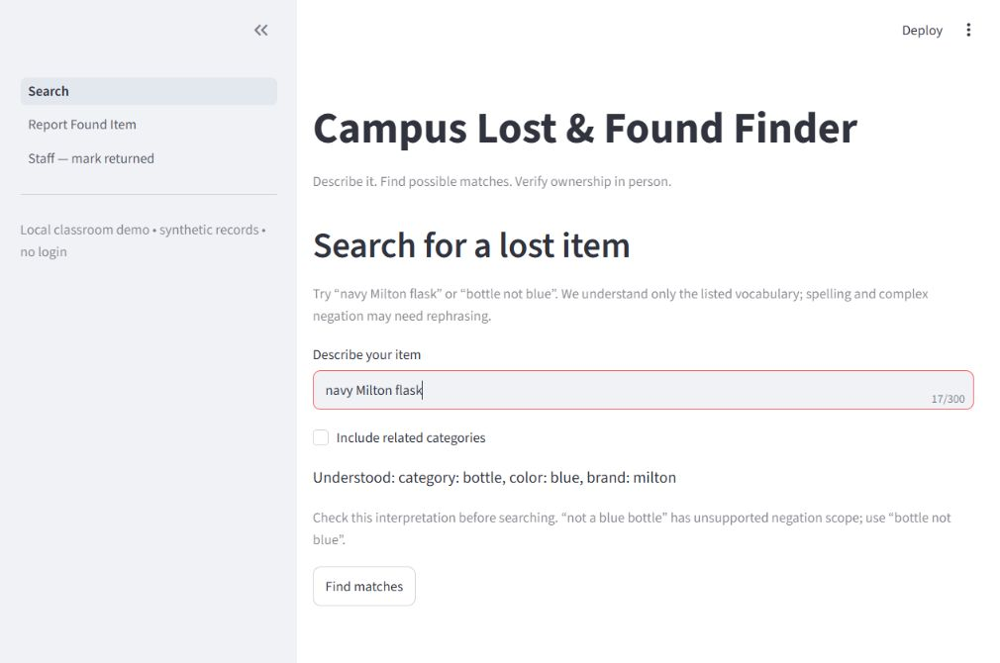
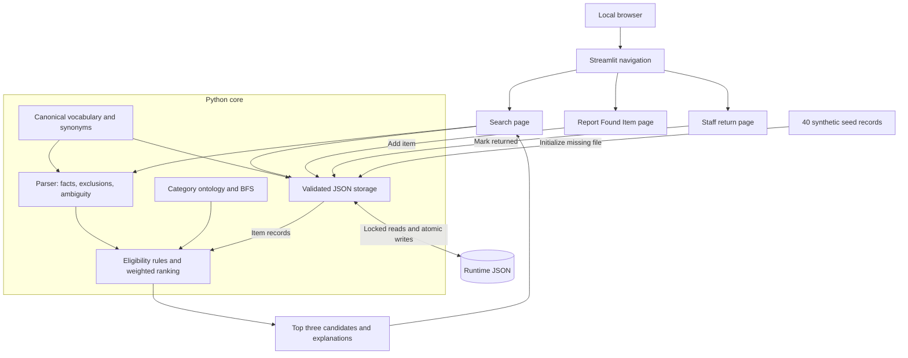
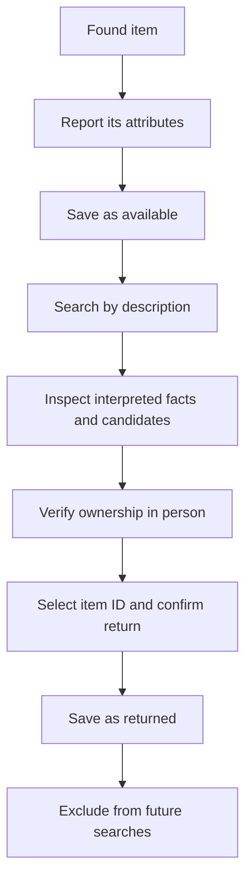

<div align="center">

# 🔎 Campus Lost & Found Finder

**Describe it. Find possible matches. Verify ownership in person.**


[](https://github.com/ananyajoshi-cseai/lost-and-found-smart-box/actions/workflows/tests.yml)

A campus lost-and-found prototype that turns short descriptions into **explainable item matches** using explicit rules, a category ontology and weighted scoring.

[Quick start](#quick-start) · [Demo](#demo-screenshots) · [System design](#system-design) · [Team](#team-and-work-division)

</div>

---

## Index

1. [Project overview](#project-overview)
2. [Features](#features)
3. [Demo screenshots](#demo-screenshots)
4. [Technology stack](#technology-stack)
5. [System design](#system-design)
6. [Application workflow](#application-workflow)
7. [How the matching works](#how-the-matching-works)
8. [Quick start](#quick-start)
9. [How to use](#how-to-use)
10. [Data and storage](#data-and-storage)
11. [Team and work division](#team-and-work-division)
12. [Development workflow](#development-workflow)
13. [Tests and evaluation](#tests-and-evaluation)
14. [Repository structure](#repository-structure)
15. [Current scope and limitations](#current-scope-and-limitations)

## Project overview

Bottles, notebooks, chargers and other belongings can look very similar. A useful lost-and-found search needs to consider several details together and explain why an item appears in its results.

Campus Lost & Found Finder provides a simple local workflow: record a found item, search using a short description, inspect the matching details, and mark the item returned after an in-person check.

**Description → Structured facts → Rules and scoring → Possible matches → Human verification**

The AI component uses **knowledge representation, deterministic parsing, breadth-first search (BFS) and heuristic ranking**. No ML model, deep learning, LLM API or training process is involved. The current project is a software-only Streamlit app.

## Features

| Feature | What it does |
| --- | --- |
| **Description search** | Extracts category, color, brand, location and identifying mark from supported words. |
| **Synonym handling** | Maps phrases such as `navy` to `blue` and `flask` to `bottle`. |
| **Exclusions and clarification** | Handles `bottle not blue`; requests clarification for conflicts such as `red blue bottle`. |
| **Explainable ranking** | Shows up to three candidates with scores, supplied-attribute coverage and a points table. |
| **Related-category search** | Optionally explores the ontology using BFS when no eligible exact-category item exists. |
| **Found-item reporting** | Saves a structured item record with a unique ID. |
| **Return tracking** | Records a return after human confirmation and excludes the item from future searches. |
| **Local persistence** | Retains reports and returns in JSON across app restarts. |

## Demo screenshots

Screenshots of the running app with synthetic demo records. The report and staff images show the forms before submission.

### Search by description



### Understand a match

For `navy Milton flask`, the parser recognizes a blue Milton bottle. This candidate matches all three supplied attributes.


<details>
<summary><strong>View the found-item and return screens</strong></summary>

### Report a found item

Choose supported attributes and save the record.


### Mark an item returned

Select the item ID and confirm the independent return check.


</details>

## Technology stack

| Layer | Technology | Purpose |
| --- | --- | --- |
| Application | Python 3.12 | Parsing, rules, ranking and storage |
| Interface | Streamlit | Search, report and return pages |
| Knowledge | Dictionaries and category graph | Canonical vocabulary, aliases and relationships |
| Search | BFS and weighted matching | Related-category exploration and ranking |
| Persistence | JSON, FileLock, atomic replacement | Validated local reads and writes |
| Verification | pytest and Streamlit AppTest | Reasoning, storage and interface checks |
| CI | GitHub Actions | Dependency validation and automated tests |

## System design

All application logic runs inside one local Python application. Streamlit pages call the core functions directly.



| Integration point | Input | Output or effect |
| --- | --- | --- |
| `engine.parse(text)` | Description | `positive`, `excluded` and `ambiguous` fields |
| `engine.rank(query, items, broaden=False)` | Parsed query and records | Candidate IDs, scores, reasons and coverage |
| `storage.load_items()` | Configured data path | Validated item list |
| `storage.add_item(values)` | Five structured attributes | Saved item with ID and `available` status |
| `storage.mark_returned(item_id)` | Available item ID | Persists `returned` status |

## Application workflow



Ownership verification happens outside the app. The Staff page records the return; it does not validate ownership evidence.

## How the matching works

### 1. Parse the description

The parser lowercases text, matches the longest supported phrases first and converts aliases into canonical values.

| Description | Interpretation |
| --- | --- |
| `navy Milton flask` | `category=bottle`, `color=blue`, `brand=milton` |
| `bottle not blue` | Bottle, excluding blue items |
| `red blue bottle` | Conflicting colors; clarification required |
| `bottle not bottle` | Conflicting inclusion and exclusion; clarification required |

### 2. Select eligible candidates

Returned items and items matching an exclusion are removed. If a category is supplied, eligible exact-category items take priority.

When there are **no eligible exact-category items** and **Include related categories** is enabled, BFS explores at most two edges in this ontology:

```text
campusitem
├── stationery
│   ├── notebook
│   └── pen
├── electronics
│   ├── charger
│   └── earphones
└── personalitems
    ├── bottle
    ├── umbrella
    └── keys
```

BFS traverses parent and child links. Related candidates receive no category points when their category differs and must still pass the score threshold. Enabling the option does not guarantee a suggestion. Low-scoring exact-category items do not trigger a second search.

### 3. Calculate the score

| Attribute | Weight |
| --- | ---: |
| Category | 40 |
| Color | 25 |
| Brand | 15 |
| Location | 10 |
| Mark | 10 |

```text
Score = 100 × matched supplied weight / total supplied positive weight
```

Only positive attributes supplied in the query count toward the denominator.

**Example:** `navy Milton flask` supplies category, color and brand. A blue Milton bottle earns `(40 + 25 + 15) / 80 × 100 = 100`. A blue Cello bottle earns `(40 + 25 + 0) / 80 × 100 = 81.25`.

Candidates below **50** are excluded. Scores are displayed to two decimals; results are ordered by displayed score descending, then item ID ascending. At most **three** are returned.

### 4. Explain the result

Each candidate shows its matching points and how many of the five attributes were supplied. A category-only query can score **100 with coverage 1/5**. The score measures text agreement; it is not a probability of ownership.

## Quick start

Prerequisites: **Git**, **Python 3.12**, and access to this repository. Internet access is needed to clone the repository and install dependencies.

### Windows PowerShell

```powershell
git clone https://github.com/ananyajoshi-cseai/lost-and-found-smart-box.git
cd lost-and-found-smart-box\finder
py -3.12 -m venv .venv
.\.venv\Scripts\python.exe -m pip install -r requirements.txt
.\.venv\Scripts\python.exe -m streamlit run streamlit_app.py
```

### macOS / Linux

```bash
git clone https://github.com/ananyajoshi-cseai/lost-and-found-smart-box.git
cd lost-and-found-smart-box/finder
python3.12 -m venv .venv
.venv/bin/python -m pip install -r requirements.txt
.venv/bin/python -m streamlit run streamlit_app.py
```

Open **http://127.0.0.1:8501**. Keep the terminal open while using the app; **Ctrl+C** stops it. These commands use the virtual environment directly, so activation is optional.

Run Streamlit from `finder/` so it loads the local configuration. The app binds to the local computer and requires no API keys, database service or hardware.

<details>
<summary><strong>Common setup issues</strong></summary>

| Problem | Fix |
| --- | --- |
| Python 3.12 is not found | Install Python 3.12, reopen the terminal and retry. |
| A package is missing | Install `requirements.txt` with the same `.venv` Python used to launch the app. |
| Port 8501 is in use | Stop the earlier app, or append `--server.port 8502` and open port 8502. |
| The item file cannot be read | Stop the app and inspect or restore the runtime JSON; retain a backup first. |
| An expected match is missing | Check interpreted facts, vocabulary, exclusions and item status. Only three results are displayed. |

</details>

## How to use

1. **Search:** enter `navy Milton flask`, check the interpreted facts and select **Find matches**. Read the points table and coverage.
2. **Try the rules:** search `bottle not blue`, then `red blue bottle`, to see exclusion and clarification behavior.
3. **Report:** open **Report Found Item**, choose the attributes, save and note the new item ID.
4. **Find the report:** search for its attributes. Similar records may rank ahead of a newly saved item; the Staff selector lists all available IDs.
5. **Record a return:** open **Staff — mark returned**, select the correct ID, verify the displayed details and complete the independent return check before confirming.
6. **Check persistence:** search again to confirm that ID is excluded. Restart the app; the saved return should remain.

For a fresh demo without changing existing data, stop the app and launch it with a new data filename from `finder/`:

```powershell
$env:FINDER_DATA_PATH = "runtime/demo-session.json"
.\.venv\Scripts\python.exe -m streamlit run streamlit_app.py
```

Use a filename that does not already exist. To return to the default data path, stop the app and run `Remove-Item Env:FINDER_DATA_PATH` in that PowerShell session before restarting. On macOS/Linux, use `FINDER_DATA_PATH=runtime/demo-session.json .venv/bin/python -m streamlit run streamlit_app.py`.

## Data and storage

The app starts with **40 synthetic records**, including repeated descriptions with different IDs to demonstrate ambiguity. These are demo examples, not real campus observations.

| File | Purpose |
| --- | --- |
| `finder/data/items.seed.json` | Committed starter data |
| `finder/runtime/items.json` | Local working data, created on first use and ignored by Git |
| `finder/evaluation/items-v1.json` | Separate frozen 20-item regression fixture |
| `finder/evaluation/queries-v1.json` | Its 18 labelled regression queries |

Each stored record has this shape:

```json
{
  "id": 101,
  "category": "bottle",
  "color": "blue",
  "brand": "milton",
  "location": "library",
  "mark": "star",
  "status": "available"
}
```

IDs are unique positive integers. Status is `available` or `returned`. Brand and mark may be `null` when not supplied; the remaining attributes must use supported canonical values.

Storage validates records, locks each read/update operation and replaces the JSON file atomically. Only a missing file is initialized from the seed; invalid existing data produces an error instead of being silently reset.

**Backup and restore:** stop the app, then copy the runtime JSON to a safe location. Before restoring a valid backup, retain a copy of the current file. No names, contact details or photos are collected by the app.

## Team and work division

| Team member | Area | Responsibilities | Main files |
| --- | --- | --- | --- |
| **Anika** | Knowledge and storage | Vocabulary and aliases, ontology, BFS, seed data quality, JSON validation and persistence | `vocabulary.py`, `ontology.py`, `storage.py`, `data/` |
| **Ananya** | Reasoning and repository | Parser, exclusions and ambiguity rules, weighted ranking, explanations, integration tests and repository coordination | `parser.py`, `scoring.py`, `engine.py`, `tests/`, CI |
| **Aashi** | Interface and evaluation | Streamlit pages and usability, demo flow, final labelled queries, evaluation analysis and presentation | `streamlit_app.py`, `views/`, `ui.py`, `evaluate.py`, `evaluation/` |

These are the team's areas of responsibility. Shared interfaces are reviewed together; final dataset review, usability checks and labelled evaluation remain team milestones.

## Development workflow

**Latest `main` → Focused branch → Small change → Local checks → Pull request → Review → Merge**

Start from the current simplified app:

```bash
git switch main
git pull --ff-only origin main
git switch -c feature/short-description
```

Keep vocabulary, stored values and interface options consistent. Add focused tests when changing reasoning or storage behavior. Run the checks below, commit the relevant files, push the branch and open a pull request describing the change and its validation.

Team coordination happens through WhatsApp; this README contains the shared project instructions.

## Tests and evaluation

From `finder/`:

```powershell
.\.venv\Scripts\python.exe -m pip check
.\.venv\Scripts\python.exe -m pytest -q
.\.venv\Scripts\python.exe evaluate.py --output runtime/evaluation.json
```

On macOS/Linux, replace `.\.venv\Scripts\python.exe` with `.venv/bin/python`. Use a new evaluation output filename for each run; the evaluator does not overwrite an existing result.

The current suite contains **49 tests** covering parsing, ranking, ontology traversal, storage and interface behavior. GitHub Actions runs dependency validation and tests on every push and pull request.

The evaluator uses the **20-item / 18-query frozen regression fixture**, separate from the app's 40 seed records. It reports top-1 and top-3 hits for positive queries and false positives for negative queries. Tests use temporary files, and the evaluator does not change runtime item data.

These checks establish repeatable behavior on synthetic examples. A separate final evaluation against the agreed dataset remains part of the team's work; regression results are not campus accuracy.

## Repository structure

```text
lost-and-found-smart-box/
├── README.md                    # Project guide
├── assets/screenshots/          # Actual app demo images
├── .github/workflows/tests.yml  # Automated checks
├── .gitignore
└── finder/
    ├── streamlit_app.py         # Entry point and navigation
    ├── requirements.txt
    ├── .streamlit/config.toml   # Local app settings
    ├── finder_core/
    │   ├── engine.py            # Interface to parsing and ranking
    │   ├── parser.py            # Facts, exclusions and ambiguity
    │   ├── vocabulary.py        # Canonical terms and aliases
    │   ├── ontology.py          # Category graph and BFS
    │   ├── scoring.py           # Eligibility and weighted ranking
    │   ├── storage.py           # JSON persistence
    │   └── ui.py                # Shared interface helpers
    ├── views/                  # Search, report and staff pages
    ├── data/                   # Synthetic seed records
    ├── tests/                  # Reasoning, storage and UI tests
    ├── evaluate.py             # Regression evaluator
    ├── evaluation/             # Frozen input fixtures
    └── runtime/                # Generated locally; ignored by Git
```

## Current scope and limitations

- **Supported vocabulary:** seven item categories, three colors, two brands, two locations and three mark values. Unknown words and misspellings are ignored; `purple bottle` can still match bottles because `purple` is not recognized.
- **Negation:** only an immediate `not`, `no` or `without` before a recognized phrase is supported. Use `bottle not blue`; `not a blue bottle` has unsupported scope.
- **Returns:** the Staff page is an unauthenticated control for a supervised local demo. The app does not collect ownership proof or submit claims.
- **Storage:** JSON is intended for this small local prototype. It is not a hosted multi-user database.
- **Project scope:** text descriptions, explicit rules and a local UI. Hardware, image recognition, trained models and external inference services are outside this version.

Further work focuses on reviewing the vocabulary and seed data, improving interface usability and completing the team's final labelled evaluation.

[Back to index](#index)
