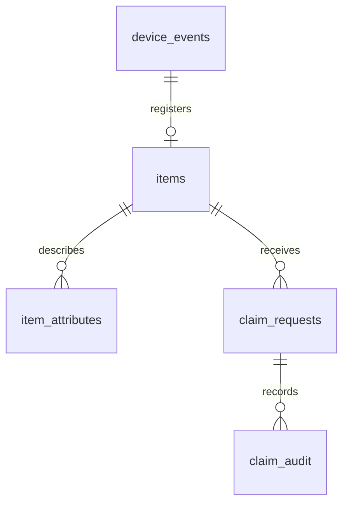

# Person B report contribution: algorithms and database

Status: backend evidence checkpoint, not a final project release. Based on merged backend commit `0626bb8e63cf0ae677026df05fb12826912b1231`. The 39-page handbook remains the source of truth; see [provenance](../source-of-truth.md). Aashi can incorporate these sections into the report after team review.

## Architecture and role boundaries

Anika's trigger produces a deposit event with a stable ID. The Python replay bridge sends saved serial JSON to FastAPI. Staff registers an item against that event using explicit category, color, location, optional brand/marks and a laptop photo. SQLite stores records; re-encoded JPEGs live outside the public static directory. Aashi's browser client calls the documented API and displays explanations supplied by the backend. Only staff can decide a claim after independent ownership checks.

A saved synthetic event exercises the backend transport but does not demonstrate a physical or Wokwi trigger. The actual browser client and Wokwi implementation remain pending at this checkpoint. No hardware purchase gate has been declared passed.

## Deterministic AI pipeline

The system uses authored vocabulary, explicit facts, rules, a category ontology and heuristic ranking. It does not train a model, compute embeddings, classify photographs or call an inference service. A photo is evidence for a human reviewer.

1. Lowercase the query and extract ASCII letter/digit tokens. Match longer authored phrases before shorter ones within each attribute. For example, navy maps to blue and flask maps to bottle.
2. Recognize immediate `not`, `no` or `without` before a recognized phrase as an exclusion. Multiple distinct positive values for one field, or the same value both positive and excluded, mark that field ambiguous. Unknown words contribute no evidence.
3. Return no ranked candidates for ambiguity or no positive facts. Otherwise exclude unavailable items and items violating an explicit negative fact.
4. If a category is supplied, use eligible exact-category items. Only when that pool is empty and `broaden=true`, search category neighbors using BFS to depth two. An existing exact-category pool prevents broadening even if none later reaches the score threshold.
5. Compute weighted agreement using only supplied positive attributes. Keep scores at least 50, sort by returned score descending then integer ID ascending, and return at most three candidates. Threshold comparison uses the unrounded score; returned scores use two decimal places.

| Attribute | Weight |
|---|---:|
| Category | 40 |
| Color | 25 |
| Brand | 15 |
| Location | 10 |
| Public mark | 10 |

`score = 100 × matched supplied weight / total supplied positive weight`.

Example: query facts are bottle, blue, milton, library, star; candidate facts are bottle, blue, milton, canteen, star. Matched weight is 40+25+15+0+10=90, denominator is 100, so score is 90 with coverage 5/5. Remove mark from the query: matched weight becomes 80 and denominator becomes 90, giving 88.89 with coverage 4/5. A bottle-only query can score 100 with coverage 1/5. None of these values is an ownership probability.

`strong_candidate` requires supplied category/color/brand all to match. It never approves a claim. Related categories receive zero category points and are explicitly labelled different-category suggestions. Private marks, claim contact and evidence do not contribute to public matching.

## Ontology and BFS

The logical parent relationships are campusitem -> stationery/electronics/personalitems, stationery -> notebook/pen, electronics -> charger/earphones, personalitems -> bottle/umbrella/keys. Traversal adjacency is bidirectional so BFS can reach a sibling through its parent; logical IsA remains parent-directed.

The queue starts with bottle at distance 0. Remove bottle, discover personalitems at 1. Remove personalitems, discover campusitem, umbrella and keys at 2; bottle is already visited. Depth-two nodes are recorded but not expanded. Thus stationery and electronics are outside this traversal. The visited-distance dictionary prevents revisits. This is breadth-first search over category nodes, not database rows; no DFS or A* is used.

BFS costs O(V+E) over visited nodes/edges. Ranking scans the item pool and scores at most five fields per eligible item, then sorts surviving candidates. The current implementation loads available records and is intended for the small supervised prototype, not an indexed large-scale search service.

## SQLite schema and integrity

| Table | Purpose | Important constraints |
|---|---|---|
| device_events | Stable deposit IDs and device IDs | event_id primary key; kind must be deposit |
| items | Canonical facts, private photo filename and availability | integer primary key; unique event_id foreign key; available/claimed status |
| item_attributes | Public and private descriptive attributes | composite primary key (item_id,name); item foreign key; private flag 0/1 |
| claim_requests | Contact, evidence and claim state | item foreign key; pending/approved/rejected; partial unique index permits only one approved claim per item |
| claim_audit | Actor, decision reason and timestamp | claim foreign key; approved/rejected action; update/delete triggers reject changes |

Foreign keys are enabled on every application connection. Registration inserts the item and attributes in one transaction; failure rolls them back and removes the newly written image. A crash can leave an orphan photo, so the read-only storage audit reports discrepancies for review.

Claim submission and decisions use BEGIN IMMEDIATE transactions. Approval conditionally changes an available item to claimed, updates the claim and appends an audit entry atomically. A competing or repeated approval returns 409. Rejection preserves item availability. Other pending claims remain pending after a winning claim, but their item_status is claimed and they cannot be approved. Staff can explicitly reject them.

The audit is append-only under the application's schema triggers; it is not tamper-proof against someone who controls the database file or can alter its schema. There is no public reset, reopen or approval route.

## API, photos and recovery

The [contract](../contracts.md) and [OpenAPI snapshot](../openapi.json) define paths and fields. Device writes use X-Device-Key; staff routes use HTTP Basic. Public search/detail/list responses allowlist safe fields. Claimed items disappear from public results, detail and photo access. JPEG/PNG uploads are size/pixel-limited, decoded and re-encoded to RGB JPEG under a UUID filename. Photos never expose the private upload directory as a static mount.

The local app serves only frontend/ at /ui/. No reviewed index exists yet, so its 503 response is expected. Optional CORS permits only the documented local frontend origins. Authentication and CORS have separate purposes. This prototype uses loopback; remote use would require HTTPS and additional deployment controls.

Recovery copies SQLite and its referenced photos while the server is stopped, records file hashes and row counts, and restores only into a fresh directory after verification. It checks integrity and foreign keys and verifies copied bytes. It does not overwrite the active data. Checksums detect corruption, not authenticity or encryption. See the [recovery exercise](../b07-walkthrough.md).

## Measured results and limitations

Use the dated [B08 evidence status](../test-results/b08-status.md) with its linked raw B05 report. The raw B08 report records a fresh clean-checkout evaluation; preserve its distinct timing measurements. The fixed synthetic-v1 dataset contains 20 items and 18 labelled queries: 12 positive, 6 negative. The B05 run recorded 12/12 top-1 and top-3 positive-query success, but 1/6 negative queries returned candidates. It also returned 14 extra irrelevant cards across positive queries. These are small authored-set retrieval results, not campus accuracy or evidence of generalization.

The retained failure is `purple bottle`: purple is outside the vocabulary, so the engine can return non-purple bottles. Other limits include ASCII/English vocabulary, unsupported negation scope such as `not a blue bottle`, ambiguous multiple colors and no typo correction. No weights, aliases, labels or thresholds have been tuned for this checkpoint.
